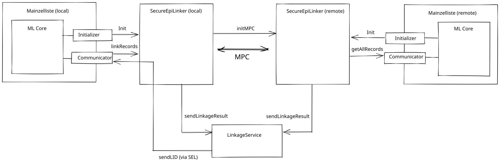

# MainSEL API Reference



This Document shows the interface and processes of the Secure linkage service as well as references to its python code. It is intended as an aid for rewriting this service.
It only shows the processes involving the linkage service, for the full overview plase reference the main branch.
Last update: 27.11.2024

## TOC

 * [Process Overview](#process-overview)
 * [Preliminaries](#preliminaries)
 * [User-Facing API Endpoints](#user-facing-api-endpoints)
 * [Setup for Linkage ID Generation](#setup-for-linkage-id-generation)
 * [Record Linkage (L)](#record-linkage-l)

## Process Overview

 0. Setup for linkage
 1. Initialization (I)
 2. Linkage / Matching (L/M)
 3. Computation (C)
 4. Results / Status (S)

Steps 2. and 3. are interleaved.

## Preliminaries

### Abbreviations

 * **ML**: Mainzelliste
 * **SEL**: SecureEpilinker
 * **LS**: LinkageService
 * **LID**: Linkage ID

### Global SEL Identifier
Each ML has a global ID, which consists of the character set `[a-zA-Z0-9_]`
(i.e. alphanumeric plus '_'). This global ID is also registered at the
LS for LID management. Under this ID the LS stores the
Identifier Encryption Keys and each global ID is assigned to an API key.

### Authorization
The reference implementation uses a protocol based on HTTP BASIC authentication.
The APIKey passed in the initialization phase is transmitted as an HTTP header
in the following way:
```
Authorization: apiKey apiKey="<APIKey>"
```
Thus, the specification follows [rfc2617](http://www.ietf.org/rfc/rfc2617.txt).

### MainSEL Registration
Each new MainSEL in the federation must register its global ID with the Linkage
Service (LS). The LS then generates a secret key for this party for LID
(re)encryption. For security reasons, this process must be deliberately
performed locally by the LS administrator and is not exposed via a REST API.

This corresponds to lines 14 to 16 in main.py

### InitIDs
Since the L.1 call assumes that LIDs already exist in the remote ML, they must
initially be generated for the remote party.

This interface is implemented in lines 33 to 37 in main.py with the generation logic in lines 40 - 48 in secureepilinker.py

#### Request
The ML designated as remote sends a
**HTTP GET** request to the linkage service address
`https://{linkage-service}:{ls-port}/freshIDs/<ML_id>?count=n` to obtain n valid
IDs, where n is the size of the entire ML database. A ML can only request valid
IDs for itself.

### Response
For a successful request, "200 OK" is sent with the generated LIDs as a JSON
object in the response body.

In case of a failed authentication "401 Unauthorized" is sent.

In case of an invalid request syntax "400 Bad Request" is sent.

If the LS is in an error state, it will respond with "500 Internal Server Error"
or "503 Service Unavailable". In the latter case a recovery time is sent with
the "Retry-After" header if possible.

### Example
```
// HTTP - GET Request http://<linkage-service>/freshIDs/<global-ML-id>?count=n
// Authentication via HTTP header
// Response: base64 encoded list of n new ids
{
'linkageIds': [
'Rm9vQmF...yCg==',
...
'QmFyQmF...6Cg=='
]
```

### TestConnection
To finish the initialization process, the SEL tests its connection to the given LS. This also validates that the SEL is actually registered at the LS.

#### Request
Both SELs send a **HTTP GET** request to the linkage service address
`https://{linkage-service}:{ls-port}/testConnection/<ML_id>`. 
This interface is implemented in lines 23-30 in main.py

### Response
For a successful request, "204 No Content" is sent. 

if the SEL is not registered (with the provided id), "403 Forbidden" is sent with "Host not configured" in the message body.

If the LS is in an error state, it will respond with "500 Internal Server Error"
or "503 Service Unavailable". In the latter case a recovery time is sent with
the "Retry-After" header if possible.

### Example
```
// HTTP - GET Request http://<linkage-service>/testConnection/<global-ML-id>
// Response: 204 No Content
```

## Record Linkage (L)
This process links (a) local record(s) against the remote database. This process
can occur any number of times in succession once process I (initialization) has
been successfully executed.


|      | Name              | Description                                                                                       | Caller           | Callee | API Endpoint at Callee   |
|------|-------------------|---------------------------------------------------------------------------------------------------|------------------|--------|--------------------------|
| L.2  | sendLinkageResult | Both SELs send their XOR shares to the linkage service. The resulting LID(s) are in the response  | local+remote SEL | LS     | /linkageResult           |


### Step L.2: sendLinkageResult

This interface is implemented in lines 44 to 75 in main.py. The logic of correectly pairing ids and roles to the right computation (in case there are multiple concurrent linkage processes) is done in lines 22 to 41 in linkageservice.py. The logic of creating the resulting LID is in lines 56 to 89 of linkresult.py

#### Request
Both SELs send a **HTTP POST** request to the configured LS address. The
reference implementation uses the address
`https://{LS-host}:{LS-port}/linkageResult/<local_id>/<remote_id>`.
The Request contains a JSON object with the following properties:

 1. role
    * server
    * client
 2. result
    1. match bit share
    2. tentative match bit share
    3. bestIndex share
 3. encrypted LIDs, if role == server

#### Response
The LS responds to the client with a JSON object containing one or more linkage
IDs results. Optionally, the LS may include a warning field or, in case of a
failed calculation, an error description.

#### Example
```
// HTTP POST of both SEL to LS https://ls.mitro.dkfz.de/linkageResult/<local-id>/<remote-id>
{
  "role": "server" // or "client"
    "result": {
      "match": 0, // XOR share of match bit
        "tentativeMatch": 1, // XOR share of tentative match bit
        "bestIndex" : 4 // XOR share of best match index
    },
    "ids": ["FooBar=", ...] // only if role == server
}
```
LS reply to client:
```
{
  "result": [
  {"linkageId": "FooBar=" // base64 encoded linkage id, encrypted with key for local ML},
  {"linkageId": "FooBar=" // base64 encoded linkage id, encrypted with key for local ML},
  ...
  ],
  "warning": "The following problem occurred during computation: ....",
  "error": "Linkage server timeout" // Only if no result was generated
}
```
